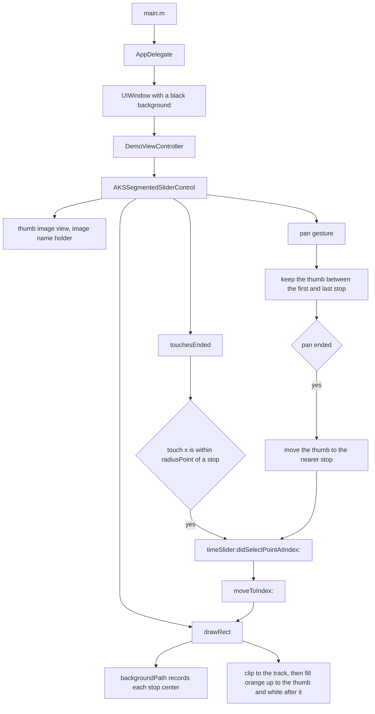

# AksSegmentedSliderControl

[](https://github.com/aryansbtloe/AksSegmentedSliderControl)
[](https://github.com/aryansbtloe/AksSegmentedSliderControl)
[](LICENSE)

An easy to use segmented slider control for iOS applications. `AKSSegmentedSliderControl` is a `UIView` subclass that draws a horizontal row of circular stops joined by a track, moves a thumb image between those stops, and paints the track orange up to the thumb and white after it. A tap on a stop, or a pan that ends nearer one stop than another, selects that stop and, when a delegate is set, calls `timeSlider:didSelectPointAtIndex:`. The repository is the control together with a small UIKit demo that places one slider on a black window.

## Features

- A segmented track drawn with `UIBezierPath`: circular stops connected by a straight bar, clipped and filled as the thumb moves.
- Configurable stop count, spacing, stop radius, and bar thickness.
- A thumb image view loaded with `[UIImage imageNamed:@"holder"]`. The assets are `holder.png` (37×37) and `holder@2x.png` (74×74). The image view is sized from `image.size` (37×37 points) and is not clipped to the control bounds.
- A pan gesture that drags the thumb horizontally between the first and last stop. While the finger is down, `drawRect` follows the thumb. When the pan ends, the thumb snaps to the nearer stop.
- A tap that selects a stop when the touch x-coordinate is within `radiusPoint` of that stop’s center.
- `touchEnabled`, which gates both the tap and the pan. It defaults to `YES`.
- An optional delegate callback that receives the selected index.
- `moveToIndex:` to place the thumb on a stop. This updates `currentIndex` and does not call the delegate.
- `currentIndex`, a read-only index updated by `moveToIndex:`.
- `positionForPointAtIndex:` to read a stop center in the control’s coordinate space.
- Stroke colour, stroke width, shadow colour, shadow offset, and shadow blur as properties of the track.

## How selection works

`main.m` starts UIKit with `AppDelegate`. The delegate creates a full-screen window, sets its background to black, and installs `DemoViewController` as the root. The demo’s `viewDidLoad` calls `prepareSlider`, which creates one `AKSSegmentedSliderControl`.



Taps and pans are ignored when `touchEnabled` is `NO`. The delegate is called only after a tap hits a stop or a pan snaps to one. `moveToIndex:` runs after that callback, so `currentIndex` inside the callback is still the previous index. The `index` argument is the newly selected stop.

## Requirements

- Objective-C and UIKit, with Automatic Reference Counting. The project sets `CLANG_ENABLE_OBJC_ARC` to `YES` for Debug and Release.
- The sample project sets `IPHONEOS_DEPLOYMENT_TARGET` to **6.1**, `SDKROOT` to `iphoneos`, and `TARGETED_DEVICE_FAMILY` to iPhone and iPad (`1,2`).
- Xcode. The project `compatibilityVersion` is Xcode 3.2, and `LastUpgradeCheck` is `0460` (Xcode 4.6).
- Frameworks linked by the sample target: UIKit, Foundation, and CoreGraphics. `AKSSegmentedSliderControl.h` also imports QuartzCore.
- `AksSegmentedSliderControl-Info.plist` requires the `armv7` device capability, allows portrait plus both landscapes on iPhone, and allows all four orientations on iPad. `CFBundleShortVersionString` and `CFBundleVersion` are `1.0`. The bundle identifier is `com.kiplmobile24.${PRODUCT_NAME:rfc1034identifier}`.
- A development code signing identity for device builds. The project sets `CODE_SIGN_IDENTITY[sdk=iphoneos*]` to `iPhone Developer`.

`AksSegmentedSliderControl-Prefix.pch` imports UIKit and Foundation for Objective-C sources, and it warns if the base SDK is older than iOS 3.0. The deployment target configured on this project is iOS 6.1.

## Installation

The repository is a single Xcode application target named `AksSegmentedSliderControl`. There is no podspec, `Podfile`, or `Package.swift`, so there is no CocoaPods or Swift Package Manager setup. Open the sample project, or copy the control files into an existing iOS target.

### Run the sample

1. Clone this repository.
2. Open `AksSegmentedSliderControl.xcodeproj`.
3. Build and run the `AksSegmentedSliderControl` target.

### Add the control to another app

Add these files to the application target. The two images must be copied into the bundle, and the implementation must be compiled:

- `AksSegmentedSliderControl/AKSSegmentedSliderControl.h`
- `AksSegmentedSliderControl/AKSSegmentedSliderControl.m`
- `AksSegmentedSliderControl/holder.png`
- `AksSegmentedSliderControl/holder@2x.png`

Keep the resource name `holder`. `initWithFrame:` loads it with `[UIImage imageNamed:@"holder"]` and builds the thumb from that image. The target that compiles the control needs Automatic Reference Counting, matching the sample project.

## Usage

The delegate protocol is declared in `AKSSegmentedSliderControl.h`. The only method is optional, and its selector is `timeSlider:didSelectPointAtIndex:`.

```objc
@class AKSSegmentedSliderControl;
@protocol AKSSegmentedSliderControlDelegate <NSObject>
@optional
- (void)timeSlider:(AKSSegmentedSliderControl *)timeSlider didSelectPointAtIndex:(int)index;

@end
```

`DemoViewController` creates the slider in `prepareSlider`. The local frame variable is spelled `sliderConrolFrame` in the sample. `numberOfPoints` is left at its default of 5, and `moveToIndex:2` selects the middle stop. The y origin on screen is `242 + 6.5`.

```objc
#define WIDTH  282
#define HEIGHT 34
#define X_POS  20
#define Y_POS  242
#define RADIUS_POINT  10
#define SPACE_BETWEEN_POINTS  44.75
#define SLIDER_LINE_WIDTH     9

CGRect sliderConrolFrame = CGRectMake(X_POS, Y_POS + 6.5, WIDTH, HEIGHT);

AKSSegmentedSliderControl *sliderControl = [[AKSSegmentedSliderControl alloc] initWithFrame:sliderConrolFrame];
[sliderControl setDelegate:self];
[sliderControl moveToIndex:2];
[sliderControl setSpaceBetweenPoints:SPACE_BETWEEN_POINTS];
[sliderControl setRadiusPoint:RADIUS_POINT];
[sliderControl setHeightLine:SLIDER_LINE_WIDTH];
[self.view addSubview:sliderControl];
```

The sample callback is empty. `index` is the stop that was tapped or snapped to:

```objc
- (void)timeSlider:(AKSSegmentedSliderControl *)timeSlider didSelectPointAtIndex:(int)index {

}
```

`DemoViewController.h` does not declare `<AKSSegmentedSliderControlDelegate>`. The demo implements the method and passes `self` to `setDelegate:`.

Two methods are public:

```objc
- (void)moveToIndex:(int)index;
- (CGPoint)positionForPointAtIndex:(int)index;
```

`moveToIndex:` stores the index and, once `backgroundPath` has recorded stop centers, moves the thumb to that center and redraws. Calling it before the first draw still stores `currentIndex`. The first `drawRect` then places the thumb, which is how the demo’s `moveToIndex:2` works before the view is on screen.

`positionForPointAtIndex:` returns a center from the array filled by `backgroundPath` during drawing. Use an index inside the current stop count after the control has drawn.

## Project structure

The Xcode groups **Slide Control** and **Supporting Files** are groups only. On disk, the sources and images share `AksSegmentedSliderControl/`.

```
.
├── LICENSE
├── README.md
├── AksSegmentedSliderControl.xcodeproj
│   ├── project.pbxproj
│   └── xcuserdata                 # checked-in scheme and breakpoints
└── AksSegmentedSliderControl
    ├── AKSSegmentedSliderControl.h
    ├── AKSSegmentedSliderControl.m
    ├── holder.png                 # 37 × 37 thumb
    ├── holder@2x.png              # 74 × 74 thumb
    ├── AppDelegate.h
    ├── AppDelegate.m
    ├── DemoViewController.h
    ├── DemoViewController.m
    ├── main.m
    ├── AksSegmentedSliderControl-Info.plist
    ├── AksSegmentedSliderControl-Prefix.pch
    ├── en.lproj/InfoPlist.strings
    ├── Default.png                # 320 × 480 launch image
    ├── Default@2x.png             # 640 × 960 launch image
    └── Default-568h@2x.png        # 640 × 1136 launch image
```

| Path | Role |
| --- | --- |
| `AKSSegmentedSliderControl.h`, `AKSSegmentedSliderControl.m` | Slider view, delegate protocol, drawing, and gestures. |
| `holder.png`, `holder@2x.png` | Thumb images, loaded by the name `holder`. |
| `DemoViewController.m` | Builds one slider and implements the delegate method. |
| `AppDelegate.m` | Creates the black window and shows the demo. |
| `main.m` | Calls `UIApplicationMain` with `AppDelegate`. |
| `AksSegmentedSliderControl-Info.plist` | Bundle identifier, version `1.0`, orientations, and `armv7`. |
| `AksSegmentedSliderControl-Prefix.pch` | Prefix header for the application target. |
| `en.lproj/InfoPlist.strings` | Empty strings table for localized Info.plist keys. |
| `Default.png`, `Default@2x.png`, `Default-568h@2x.png` | iPhone launch images shipped as resources. |

## Customisation

`initWithFrame:` applies the defaults below and clears the view background. Setters that change drawing call `setNeedsDisplay`.

| Property | Default | What the implementation does with it |
| --- | --- | --- |
| `numberOfPoints` | `5` | Declared as `float`. The setter stores an `int`. The stored value is raised to at least `2`, and to at least `currentIndex + 1` when that is larger. |
| `spaceBetweenPoints` | `40` | Extra horizontal gap, in points, added between stop centers along with the stop diameter. |
| `radiusPoint` | `10` | Radius of each circular stop, and the x-distance that counts as a tap on a stop. If `radiusCircle` is greater than `radiusPoint - 4`, the radius becomes `radiusCircle + 4`. |
| `heightLine` | `10` | Thickness of the bar between stops. Values above `radiusPoint * 2` are reduced to that limit. |
| `strokeSize` | `1` | Line width of the track path. Added into every stop’s center. |
| `strokeColor` | black | Stroke colour of the track path. |
| `shadowSize` | `(2, 2)` | Shadow offset passed to `CGContextSetShadowWithColor`. |
| `shadowBlur` | `2` | Shadow blur radius. |
| `shadowColor` | black, alpha `0.30` | Shadow colour. |
| `touchEnabled` | `YES` | When `YES`, a hit tap or a completed pan can change the selection. |
| `currentIndex` | `0` | Read-only. Updated inside `moveToIndex:`. |
| `radiusCircle` | `2` | Kept at most `radiusPoint - 4`, and used when clamping `radiusPoint`. `drawRect` does not paint an inner circle from it. |
| `gradientForeground` | white to gray `0.793` | `CGGradientRef` created in `initWithFrame:`. Replacing it marks the view dirty. `drawRect` does not sample it. |
| `strokeColorForeground` | gray `0.3`, alpha `1` | Retained colour. `drawRect` does not read it. |
| `strokeSizeForeground` | `1` | Assigning it marks the view dirty. `drawRect` does not read it. |
| `delegate` | `nil` | `assign` property of type `id<AKSSegmentedSliderControlDelegate>`. |

`backgroundPath` places stop `i` (counting from zero) at:

```text
center.x = radiusPoint + i * (spaceBetweenPoints + radiusPoint * 2) + strokeSize
center.y = radiusPoint + strokeSize
```

With the demo values (five stops, spacing `44.75`, radius `10`, stroke `1`), stop 4 is centered at x = 270 and its circle ends at x = 280. The demo frame is 282 points wide, so that track fits. The frame is chosen by the caller. A larger count, spacing, radius, or stroke can draw past the bounds.

`drawRect` strokes and fills that path, clips to it, then fills the bounds to the left of the thumb with `[UIColor orangeColor]` and the rest with white. The orange and white colours are fixed in code. The shadow set on the graphics context covers that drawing. The thumb image stays above the track as a subview.

The leftmost and rightmost pan limits are stored in static variables the first time a drag asks for them. A later change to `numberOfPoints` or spacing does not refresh those cached limits.

`prepareSlider` also defines `IPHONE_4_SUPPORT` as `88`. The demo never reads that macro.

## Contributing

Issues and pull requests are welcome at [github.com/aryansbtloe/AksSegmentedSliderControl](https://github.com/aryansbtloe/AksSegmentedSliderControl).

1. Fork the repository and branch from `master`.
2. Keep the change focused. Slider drawing and selection live in `AKSSegmentedSliderControl.m`. The sample window and the sample slider live in `AppDelegate.m` and `DemoViewController.m`.
3. Open `AksSegmentedSliderControl.xcodeproj` and run the `AksSegmentedSliderControl` target after a change to drawing or selection.
4. Open a pull request against `master` and describe the behaviour you changed.

The Xcode project has one application target and no test target.

## License

This repository is released under the [MIT License](LICENSE). Copyright (c) 2026 Alok Singh.

The existing source headers still say Copyright (c) 2013 Konstant Info Private Limited. The Xcode project’s `ORGANIZATIONNAME` is that same company.

## Author

**Alok Singh**

- GitHub: [https://github.com/aryansbtloe](https://github.com/aryansbtloe)
- Website: [https://bestlatestapps.com](https://bestlatestapps.com)
